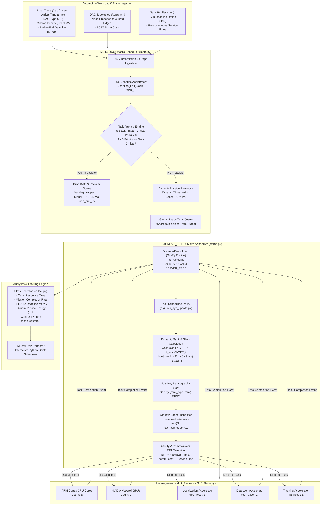
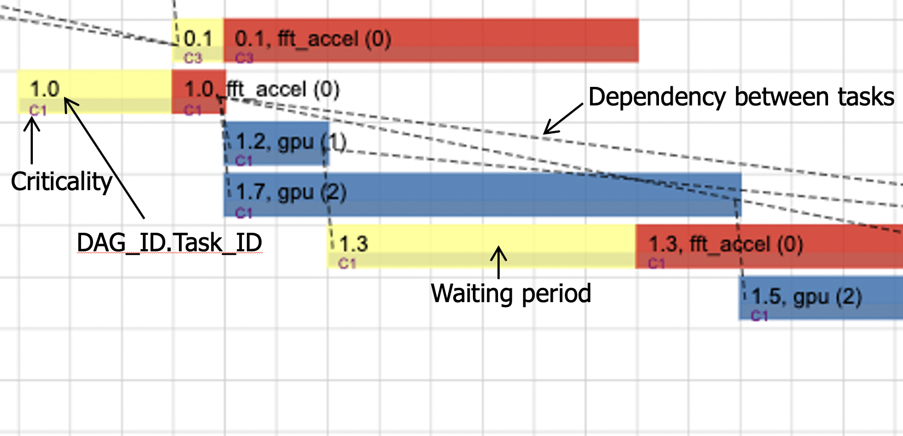

# AVSched: Quality-of-Mission Aware Scheduling for Autonomous Vehicle SoCs

> **Heterogeneity-Aware, Multi-Step Real-Time Task Scheduling and Discrete-Event Simulation Framework for Autonomous Vehicle System-on-Chips (SoCs)**

[](LICENSE)
[](requirements.txt)
[](simulator/)
[](inputs/stomp_real.json)
[](https://ieeexplore.ieee.org/document/9446979)

---

## Overview

**AVSched** is a heterogeneity-aware, multi-step real-time scheduler designed for modern Autonomous Vehicle System-on-Chips (SoCs). Operating at the convergence of cyber-physical systems, real-time operating systems (RTOS), and heterogeneous computer architecture, AVSched optimizes overall vehicle **Quality-of-Mission (QoM)** by exploiting dynamic runtime hardware state, application-level timing constraints, and continuous task traffic backlogs.

Autonomous vehicle workloads execute as complex Directed Acyclic Graph (DAG) pipelines containing computer vision, point-cloud localization, deep learning detection, Kalman-filter tracking, sensor fusion, and trajectory motion planning. Running these concurrent pipelines on resource-constrained heterogeneous processors (multicore CPUs, GPUs, and domain-specific hardware accelerators) creates severe core contention, unpredictable execution jitter, and cascading deadline misses.

AVSched addresses these architectural challenges by introducing two multi-step scheduling policies—**$\text{MS}_{\text{stat}}$** and **$\text{MS}_{\text{dyn}}$**—coupled with three runtime scheduling optimizations: **Task Pruning**, **Hybrid Heterogeneous Ranking**, and **Dynamic Rank Update**. The entire framework is implemented on **STOMP** (*Scheduling Techniques Optimization in heterogeneous Multi-Processors*), a modular, queue-based discrete-event simulation engine built on SimPy and validated against physical automotive SoC dev boards (NVIDIA Jetson TX1/Drive platforms).

---

## Table of Contents

- [Research Motivation](#research-motivation)
- [System Architecture & Execution Flow](#system-architecture--execution-flow)
- [Technical Background & Mathematical Formulations](#technical-background--mathematical-formulations)
- [Scheduling Policies: MSstat and MSdyn](#scheduling-policies-msstat-and-msdyn)
- [Scheduling Optimizations](#scheduling-optimizations)
  - [1. Task Pruning (Selective Dropping)](#1-task-pruning-selective-dropping)
  - [2. Hybrid Heterogeneous Ranking](#2-hybrid-heterogeneous-ranking)
  - [3. Dynamic Rank Update](#3-dynamic-rank-update)
  - [4. Window-Based Non-Head-of-Line Issuing](#4-window-based-non-head-of-line-issuing)
  - [5. Dynamic Mission Promotion](#5-dynamic-mission-promotion)
- [STOMP Simulation Framework](#stomp-simulation-framework)
- [Hardware & Workload Characterization](#hardware--workload-characterization)
- [Implementation Details & Software Architecture](#implementation-details--software-architecture)
- [Repository Structure](#repository-structure)
- [Installation & Environment Setup](#installation--environment-setup)
- [Execution & Configuration Guide](#execution--configuration-guide)
- [Performance Metrics & Evaluation](#performance-metrics--evaluation)
- [Extending AVSched](#extending-avsched)
- [Research Contributions & Limitations](#research-contributions--limitations)
- [Citation & References](#citation--references)
- [Contributors & Contact](#contributors--contact)

---

## Research Motivation

Autonomous driving systems present compute constraints distinct from general-purpose desktop or cloud server environments:

```
                  Automotive Cyber-Physical Requirements
┌───────────────────────────────────┬───────────────────────────────────┐
│        Real-Time Constraints       │      Heterogeneous Hardware       │
│  - Millisecond sensor deadlines   │  - Asymmetric ARM CPU clusters    │
│  - Strict end-to-end latency      │  - Power-hungry GPU engines       │
│  - ASIL-D functional safety       │  - Fixed-function ASIC pipelines  │
├───────────────────────────────────┼───────────────────────────────────┤
│        Traffic Burstiness         │       Quality-of-Mission (QoM)    │
│  - Clutter-induced latency jitter │  - Multi-tier task criticality    │
│  - Unpredictable object surges    │  - Non-critical task starvation   │
│  - Scheduling domino collapse     │  - Holistic mission throughput    │
└───────────────────────────────────┴───────────────────────────────────┘
```

1. **Severe Hardware Heterogeneity**: Modern automotive SoCs combine multicore ARM CPUs with GPUs and dedicated ASICs for Localization (`loc_accel`), Object Detection (`det_accel`), and Multi-Object Tracking (`tra_accel`). While dedicated ASICs execute specific kernels orders of magnitude faster and at a fraction of the power of general-purpose cores, they are functionally inflexible.
2. **Shortcomings of Conventional Schedulers**: Classical real-time heuristics such as Earliest Deadline First (EDF) and Heterogeneous Earliest Finish Time (HEFT) make greedy, local allocation decisions. They ignore inter-task communication affinities, fail to anticipate queued hardware delays, and suffer from **scheduling domino effects** under transient overload—wasting compute cycles on doomed tasks while starving subsequent feasible missions.
3. **Quality-of-Mission (QoM) Optimization**: Not all tasks are created equal. An autonomous vehicle simultaneously runs safety-critical tasks (collision avoidance, path planning) alongside lower-priority tasks (mapping updates, frontier exploration). Rather than maximizing raw IPC or treating deadlines as isolated binary goals, a scheduler must guarantee safety-critical deadlines while dynamically maximizing the throughput of completed end-to-end missions.

---

## System Architecture & Execution Flow

AVSched decomposes the scheduling problem into a coordinated two-tier hierarchy: **META** (Application/DAG level management) and **STOMP / TSCHED** (Heterogeneous task-to-server allocation).

### 1. High-Level System Architecture



### 2. Task Scheduling Decision Lifecycle

```mermaid
sequenceDiagram
    autonumber
    participant Trace as Input Trace
    participant META as META Macro-Scheduler
    participant TSCHED as TSCHED (STOMP Policy)
    participant HW as Heterogeneous PE (CPU/GPU/ASIC)

    Trace->>META: Arrive DAG(id, type, priority, deadline)
    Note over META: Compute Sub-Deadlines via SDR<br/>Evaluate Task Pruning on Ingress
    alt Infeasible Non-Critical DAG (Slack - BCET_crit < 0)
        META->>META: Drop DAG (dag.dropped = 1)
        META-->>TSCHED: Issue Drop Hint to clean pending tasks
    else Feasible DAG
        META->>META: Find in-degree == 0 Root Tasks
        META->>TSCHED: Push task to global ready queue & Interrupt SimPy
        activate TSCHED
        TSCHED->>TSCHED: Recompute dynamic slacks (wcet_slack, bcet_slack)
        TSCHED->>TSCHED: Assign rank and rank_type (0 to 5)
        TSCHED->>TSCHED: Sort tasks by (rank_type, rank) DESC
        loop Window Inspection (Depth <= 10)
            TSCHED->>TSCHED: Evaluate candidate servers factoring busy time & comm cost
            alt Server is Available (Idle)
                TSCHED->>HW: Assign task & Lock Server
                TSCHED->>TSCHED: Record Issue Position Histogram
                break Task Dispatched
            else Server Busy
                TSCHED->>TSCHED: Store candidate server index; Inspect next ready task
            end
        end
        deactivate TSCHED
        HW-->>META: Task Completes (Execution + Comm Cost)
        META->>META: Decrement Successor In-Degrees
        opt Successors Become Ready (in-degree == 0)
            META->>TSCHED: Push new ready subtasks
        end
    end
```

---

## Technical Background & Mathematical Formulations

### 1. Heterogeneous SoC Architecture Model
The target System-on-Chip consists of $M$ processing elements:
$$\mathcal{P} = \{PE_1, PE_2, \dots, PE_M\}$$
Partitioned into asymmetric server types:
$$\mathcal{P} = \mathcal{P}_{\text{CPU}} \cup \mathcal{P}_{\text{GPU}} \cup \mathcal{P}_{\text{ACCEL}}$$

For any task $v_i$ of type $T$, its execution time on processor $PE_k$ is specified by the mean service time vector:
$$w(v_i, PE_k) = \text{mean\_service\_time}[T][PE_k.type]$$
If $PE_k$ cannot physically execute task $v_i$, $w(v_i, PE_k) = \infty$.

### 2. Communication and Data Affinity Overhead
When task $v_i$ executes on processor $PE_k$, data produced by its predecessor tasks $pred(v_i)$ must be transferred across the interconnect. AVSched models communication latency $c(v_p, v_i)$ as:
$$c(v_p, v_i) = \begin{cases} 
0, & \text{if } PE(v_p) == PE(v_i) \text{ and } v_p \text{ immediately preceded } v_i \\
\text{comm\_cost}[T][PE(v_p).type][PE_k.type], & \text{otherwise}
\end{cases}$$
Additionally, tasks requiring static parameter reloading (e.g., deep neural network weights or FFT twiddle factors) incur a cold-start reload penalty $\text{data\_cost}[T][PE_k.type]$ if the server's previous job executed a different task type.

### 3. Application DAG and Sub-Deadline Ratio (SDR) Formulation
Each autonomous driving application is modeled as a Directed Acyclic Graph $G = (\mathcal{V}, \mathcal{E})$ with an end-to-end deadline $D_{\text{dag}}$ and release time $t_{\text{arr}}$. To prevent greedy intermediate subtasks from consuming all available slack, AVSched partitions the end-to-end deadline using pre-characterized **Sub-Deadline Ratios (SDR)**:
$$d_i = \begin{cases} 
\lfloor D_{\text{dag}} \cdot \text{SDR}_i \rfloor, & \text{in } \text{MS}_{\text{stat}} \\
\lfloor \text{Slack}_{\text{remaining}}(t) \cdot \text{SDR}_i \rfloor, & \text{in } \text{MS}_{\text{dyn}}
\end{cases}$$
where $\text{SDR}_i \in (0, 1]$ represents the normalized proportion of execution budget allocated to subtask $v_i$ based on its critical path depth.

---

## Scheduling Policies: MSstat and MSdyn

AVSched implements two primary multi-step scheduling policies located in `simulator/task_policies/`:

### MSstat (Multi-Step Static Scheduling)
* **Source Implementation**: [`simulator/task_policies/ms.py`](simulator/task_policies/ms.py) and [`simulator/meta_policies/ms.py`](simulator/meta_policies/ms.py)
* **Operational Principle**: Tasks are statically ranked upon DAG entry. The ranking is computed from the initial deadline and does not adapt as the task waits in the ready queue.
* **Algorithm**:
  1. Upon arrival at $t_{\text{arr}}$, META computes static task ranks using initial slack.
  2. Ready tasks are inserted into the ready queue.
  3. When scheduling, TSCHED evaluates ready tasks within a window of depth $\le 10$, allocating each task to the processor that yields the minimum completion time.

### MSdyn (Multi-Step Dynamic Scheduling)
* **Source Implementation**: [`simulator/task_policies/ms_hyb_update.py`](simulator/task_policies/ms_hyb_update.py)
* **Operational Principle**: Recognizes that as wall-clock simulation time $t$ advances, queued tasks lose remaining slack. MSdyn dynamically recomputes task urgency and rank at every single scheduling event using elapsed waiting time.
* **Dynamic Slack Formulation**:
  $$\text{wcet\_slack}_i(t) = d_i - (t - t_{\text{arr}, i}) - \text{WCET}_i$$
  $$\text{bcet\_slack}_i(t) = d_i - (t - t_{\text{arr}, i}) - \text{BCET}_i$$
  where $\text{WCET}_i = \max_{k} w(v_i, PE_k)$ and $\text{BCET}_i = \min_{k} w(v_i, PE_k)$ across all compatible processing elements.

### The 6-Tier Priority Ranking Matrix (`rank_type`)

Both MSstat and MSdyn map tasks into a 6-tier classification matrix based on mission criticality ($Priority > 1$ vs. $Priority == 1$) and available slack:

| Rank Type | Mission Tier | Slack Condition | Rank Mathematical Formulation | Operational Semantics |
|:---:|:---:|:---:|:---|:---|
| **5** | Critical ($Pr > 1$) | $\text{bcet\_slack} < 0$ | $\text{rank} = \left\lfloor \frac{100000 \cdot Priority}{1 + \frac{0.99}{\text{bcet\_slack}}} \right\rfloor$ | **Emergency Negative Slack**: Cannot meet deadline even on fastest PE; emergency prioritization. |
| **4** | Critical ($Pr > 1$) | $\text{bcet\_slack} \ge 0 > \text{wcet\_slack}$ | $\text{rank} = \left\lfloor \frac{100000 \cdot Priority}{1 + \text{bcet\_slack}} \right\rfloor$ | **Urgent Critical**: Can only meet deadline if scheduled on accelerated hardware (GPU/ASIC). |
| **3** | Critical ($Pr > 1$) | $\text{wcet\_slack} \ge 0$ | $\text{rank} = \left\lfloor \frac{100000 \cdot Priority}{1 + \text{wcet\_slack}} \right\rfloor$ | **Nominal Critical**: Slack available even under slowest processor execution. |
| **2** | Non-Critical ($Pr = 1$) | $\text{wcet\_slack} \ge 0$ | $\text{rank} = \left\lfloor \frac{100000 \cdot Priority}{1 + \text{wcet\_slack}} \right\rfloor$ | **Nominal Non-Critical**: Ample slack; normal execution. |
| **1** | Non-Critical ($Pr = 1$) | $\text{bcet\_slack} \ge 0 > \text{wcet\_slack}$ | $\text{rank} = \left\lfloor \frac{100000 \cdot Priority}{1 + \text{bcet\_slack}} \right\rfloor$ | **Constrained Non-Critical**: Requires hardware acceleration to finish on time. |
| **0** | Non-Critical ($Pr = 1$) | $\text{bcet\_slack} < 0$ | $\text{rank} = \left\lfloor \frac{100000 \cdot Priority}{1 + \frac{0.99}{\text{bcet\_slack}}} \right\rfloor$ | **Doomed Non-Critical**: Prime candidate for task pruning / dropping. |

Tasks are ordered lexicographically by the tuple:
$$\text{Sort Key} = (\text{task.rank\_type}, \text{task.rank}) \quad \text{[Descending]}$$

---

## Scheduling Optimizations

```
                           AVSched Optimization Pipeline
┌────────────────────────────────────────────────────────────────────────┐
│ 1. Ingress Filter: Task Pruning                                        │
│    Is (Slack - BCET_critical_path < 0) AND Priority == 1?             │
│    ├──► YES: Drop DAG immediately (Avoid domino collapse)              │
│    └──► NO:  Admit DAG to Ready Queue                                  │
├────────────────────────────────────────────────────────────────────────┤
│ 2. Priority Synthesis: Hybrid Heterogeneous Ranking                   │
│    Compute both BCET and WCET across CPU, GPU, and ASICs              │
│    Assign 6-tier rank_type (0 to 5)                                    │
├────────────────────────────────────────────────────────────────────────┤
│ 3. Runtime Feedback: Dynamic Rank Update                              │
│    Recompute slack(t) = D_i - (t - t_arr) - ExecutionTime              │
│    Re-sort queue before every dispatch cycle                           │
├────────────────────────────────────────────────────────────────────────┤
│ 4. Queue Dispatch: Window-Based Non-Head-of-Line Issuing              │
│    Scan lookahead window (depth <= 10)                                 │
│    Allow ready task on idle core to bypass busy head-of-line core      │
├────────────────────────────────────────────────────────────────────────┤
│ 5. Starvation Protection: Dynamic Mission Promotion                   │
│    If non-critical mission starved > promote_interval: Boost Pr1 -> 3  │
└────────────────────────────────────────────────────────────────────────┘
```

### 1. Task Pruning (Selective Dropping)
* **Problem Addressed**: The **scheduling domino effect**. When an autonomous vehicle encounters a compute burst, non-critical applications fall behind their deadlines. Attempting to execute them consumes hardware cycles, causing subsequent critical applications to miss their deadlines as well.
* **Mechanism**: Implemented in [`simulator/meta_policies/ms.py`](simulator/meta_policies/ms.py) (`dropping_policy`):
  ```python
  def dropping_policy(self, dag, task_node): 
      ex_time = max_length(dag.graph, task_node) # BCET along the critical path to leaf
      if (dag.slack - ex_time < 0 and dag.priority == 1):
          dag.dropped = 1
          return True
      return False
  ```
  If the best-case execution time along the remaining critical path exceeds the available DAG slack for a non-critical application, the application is dropped immediately. Furthermore, in [`simulator/task_policies/ms_hyb_update.py`](simulator/task_policies/ms_hyb_update.py), if critical tasks are pending in the system (`num_critical_tasks > 0`), non-critical tasks with `rank_type < 2` are pruned from the active queue.

### 2. Hybrid Heterogeneous Ranking
* **Problem Addressed**: Homogeneous schedulers calculate task rank assuming a single core speed. In an automotive SoC, a tracking task runs in $2\,\text{ms}$ on `tra_accel`, $17\,\text{ms}$ on GPU, and $1820\,\text{ms}$ on CPU. A single WCET metric drastically misrepresents urgency.
* **Mechanism**: Hybrid ranking explicitly tracks both $\text{BCET}_i$ and $\text{WCET}_i$ across all compatible PEs, distinguishing between tasks that can run anywhere versus tasks that strictly require accelerator dispatch to survive.

### 3. Dynamic Rank Update
* **Problem Addressed**: Static priority inversion. A task with abundant slack upon arrival becomes urgent after waiting $200\,\text{ms}$ in a congested queue.
* **Mechanism**: Before each server allocation cycle, `rank_tasks()` recalculates elapsed waiting time $t - t_{\text{arr}}$ for all queued tasks, dynamically upgrading tasks from `rank_type = 2` to `rank_type = 1` or higher as their deadlines approach.

### 4. Window-Based Non-Head-of-Line Issuing
* **Problem Addressed**: Head-of-Line (HoL) blocking. If the highest-priority task requires a GPU that is currently busy executing a 100ms inference kernel, classical strict-priority dispatch idle-stalls all other idle CPU cores and ASICs.
* **Mechanism**: Implemented using `max_task_depth_to_check = 10`. The scheduler evaluates candidate servers for tasks within the top 10 positions of the sorted ready queue. If an idle server matches a downstream task in the window, that task is issued immediately without waiting for the busy server to clear.

### 5. Dynamic Mission Promotion
* **Problem Addressed**: Starvation of non-critical missions.
* **Mechanism**: In [`simulator/meta.py`](simulator/meta.py), if ticks since last promotion exceed `promote_interval = 100 * arrival_scale * mean_arrival_time`, unserviced non-critical DAGs have their priority dynamically boosted from $1 \to 3$, guaranteeing progress during prolonged driving sequences.

---

## STOMP Simulation Framework

AVSched is built on **STOMP** (*Scheduling Techniques Optimization in heterogeneous Multi-Processors*), a modular discrete-event simulation engine evolved from the C-based **QUTE** (*Queue-based Timing Evaluation*) framework.

```
       STOMP Discrete-Event Simulation Engine
┌─────────────────────────────────────────────────────┐
│  SimPy Environment (simpy.Environment)             │
│  - SharedObjs: Clock, Event Queues, Mutexes         │
├──────────────────────────┬──────────────────────────┤
│  META (Macro-Scheduler)  │  STOMP (Micro-Scheduler) │
│  - Trace reader          │  - Server queues         │
│  - DAG dependency graph  │  - Task assignment       │
│  - Task release events   │  - Completion events     │
│  - Pruning / Promotion   │  - Energy accounting     │
├──────────────────────────┴──────────────────────────┤
│  Pluggable Task Policy Interface                    │
│  BaseSchedulingPolicy:                              │
│    - init(servers, stomp_stats, stomp_params)       │
│    - assign_task_to_server(sim_time, tasks, ...)    │
│    - remove_task_from_server(sim_time, server)      │
└─────────────────────────────────────────────────────┘
```

### Pluggable Scheduling Policy Architecture
STOMP decouples hardware modeling from scheduling logic. Researchers can implement and evaluate custom schedulers by subclassing `BaseSchedulingPolicy` and defining:
1. `init(servers, stomp_stats, stomp_params)`: Initialize internal data structures, histograms, and profiling timers.
2. `assign_task_to_server(sim_time, tasks, dags_dropped, stomp_obj)`: Core decision hook invoked when tasks arrive or servers become free.
3. `output_final_stats(sim_time)`: Export custom per-policy instrumentation metrics upon simulation teardown.

---

## Hardware & Workload Characterization

### 1. Heterogeneous Server Platform Specification
Configured in [`inputs/stomp_real.json`](inputs/stomp_real.json), matching an automotive multi-processor platform:

| Server Type | Identifier | Instance Count | Target Functional Domain | Idle / Static Power |
|:---|:---:|:---:|:---|:---:|
| `cpu_core` | `0` | **8** | OS services, Fusion, Mission/Motion Planning | $424.2\,\text{mW}$ |
| `gpu` | `1` | **2** | Deep learning vision, Feature maps | $76.9\,\text{mW}$ |
| `loc_accel` | `2` | **1** | NDT scan-matching, Particle filtering | $2.2\,\text{mW}$ |
| `det_accel` | `3` | **1** | CNN bounding-box detection (YOLO/SSD) | $2.8\,\text{mW}$ |
| `tra_accel` | `4` | **1** | Multi-target Kalman correlation | $59.0\,\text{mW}$ |

### 2. Autonomous Driving Task Profiles (ADSuite)
Characterized from real-world autonomous driving stacks:

| Task Name | Compatible Hardware | Mean Service Time ($ms$) | Active Power ($mW$) | Inherent Priority | Default Deadline ($ms$) |
|:---|:---|:---:|:---:|:---:|:---:|
| **`loc`** | `cpu_core`<br/>`gpu`<br/>`loc_accel` | $165$<br/>$95$<br/>**$10$** | $6133$<br/>$4457$<br/>**$22$** | 1 | 1000 |
| **`detect`** | `cpu_core`<br/>`gpu`<br/>`det_accel` | $3530$<br/>$156$<br/>**$96$** | $3654$<br/>$467$<br/>**$28$** | 2 | 1000 |
| **`track`** | `cpu_core`<br/>`gpu`<br/>`tra_accel` | $1820$<br/>$17$<br/>**$2$** | $5600$<br/>$12790$<br/>**$590$** | 3 | 1000 |
| **`fusion`** | `cpu_core` | **$1$** | $500$ | 4 | 1000 |
| **`mission`** | `cpu_core` | **$1$** | $3534$ | 5 | 1000 |
| **`motion`** | `cpu_core` | **$8$** | $4222$ | 6 | 1000 |
| **`collision`**| `cpu_core` | **$8$** | $500$ | 7 | 1000 |
| **`path`** | `cpu_core` | **$8$** | $500$ | 8 | 1000 |

---

## Implementation Details & Software Architecture

### Core Component Responsibility Matrix

| Component | Primary Responsibility | Verified Implementation File |
|:---|:---|:---|
| **STOMP Engine CLI** | Command-line parsing, JSON configuration merging, dynamic policy loading, and SimPy simulation lifecycle bootstrap. | [`simulator/stomp_main.py`](simulator/stomp_main.py) |
| **Micro-Scheduler (STOMP)** | Hardware server modeling, execution timing accounting, communication latency evaluation, and server queue dispatch. | [`simulator/stomp.py`](simulator/stomp.py) |
| **Macro-Scheduler (META)** | Trace-driven DAG generation, NetworkX graph dependency management, Sub-Deadline Ratio (SDR) allocation, and task promotion. | [`simulator/meta.py`](simulator/meta.py) |
| **MSdyn Policy** | Dynamic slack re-evaluation, 6-tier rank assignment, task pruning trigger, and window-based server matching. | [`simulator/task_policies/ms_hyb_update.py`](simulator/task_policies/ms_hyb_update.py) |
| **MSstat Policy** | Static priority ordering, windowed non-HoL server selection without queue-time slack updates. | [`simulator/task_policies/ms.py`](simulator/task_policies/ms.py) |
| **META MS Policy** | Ingress dropping policy evaluation (`dropping_policy`) and initial dynamic rank assignment. | [`simulator/meta_policies/ms.py`](simulator/meta_policies/ms.py) |
| **Trace Generator** | Synthetic and ADSuite arrival trace generation with Poisson/uniform timing intervals and priority assignments. | [`utils/trace_generator.py`](utils/trace_generator.py) |
| **Experiment Runner** | Parametric batch runner sweeping across arrival scale, contention, and scheduling policies. | [`utils/run_all.py`](utils/run_all.py) |
| **Metrics Collector** | Aggregates per-run telemetry (response time, mission completion, energy, core utilization) into CSV format. | [`utils/collect.py`](utils/collect.py) |
| **Gantt Visualizer** | Python-Gantt based visualizer generating SVG/PNG timeline views of CPU, GPU, and ASIC task allocations. | [`utils/stomp-viz.py`](utils/stomp-viz.py) |

---

## Repository Structure

```
AVSched/
├── inputs/                                # Workload and hardware platform definitions
│   ├── ad/                                # Autonomous Driving (ADSuite) application files
│   │   ├── dag_input/                     # NetworkX GraphML DAGs and task cost matrices
│   │   │   ├── dag0.graphml ... dag3.graphml   # Precedence topologies (Types 0-3)
│   │   │   └── dag_0.txt ... dag_3.txt         # Sub-deadline ratios (SDR) & service times
│   │   └── trace_files/                   # Pre-generated arrival traces (ad_trace_0.1 to 1.0)
│   ├── synthetic/                         # Synthetic multi-DAG benchmark files (Types 5, 7, 10)
│   ├── mapping/                           # SLAM and high-definition mapping DAG profiles
│   ├── package/                           # End-to-end mission package profiles
│   ├── stomp.json                         # Configuration for synthetic benchmark simulations
│   └── stomp_real.json                    # Configuration for real-world automotive SoC runs
├── simulator/                             # STOMP Discrete-Event Simulation Core
│   ├── stomp_main.py                      # Simulation CLI entry point
│   ├── stomp.py                           # Hardware server modeling and task event loop
│   ├── meta.py                            # DAG dependency tracking & macro-scheduling
│   ├── utils.py                           # Event queues, priority queues, and terminal formatting
│   ├── meta_policies/                     # Pluggable macro-level policies (ms, heft, rheft, edf)
│   │   ├── ms.py                          # Ingress dropping (Task Pruning) and ranking
│   │   └── heft.py                        # Standard HEFT meta policy
│   └── task_policies/                     # Pluggable micro-level dispatch policies
│       ├── ms_hyb_update.py               # Proposed MSdyn policy with dynamic rank updates
│       ├── ms.py                          # Proposed MSstat policy with static ranks
│       ├── ms_hyb.py                      # Hybrid heterogeneous ranking without updates
│       ├── ads.py                         # Baseline ADS (Xie et al., IEEE TVT 2017)
│       ├── heft.py                        # Baseline HEFT (Topcuoglu et al., 2002)
│       ├── rheft.py                       # Baseline Robust HEFT
│       ├── edf.py                         # Baseline Earliest Deadline First
│       └── edf_eft.py                     # Baseline EDF with Earliest Finish Time
├── utils/                                 # Experiment orchestration and visualization tools
│   ├── run_all.py                         # Multi-parameter batch simulation runner
│   ├── collect.py                         # Results parser and CSV telemetry generator
│   ├── stomp-viz.py                       # Gantt chart visualization tool
│   └── trace_generator.py                 # Reproducible DAG trace synthesis tool
├── Makefile                               # Fast build and execution targets
├── requirements.txt                       # Python dependency requirements
├── PROJECT_GUIDE.md                       # Research paper implementation notes
├── TRACES.md                              # Input trace format specification
├── LICENSE                                # GNU General Public License v3.0
└── stomp-viz-example.png                  # Sample Gantt chart output generated by STOMP-Viz
```

---

## Installation & Environment Setup

### Prerequisites
* **Operating System**: Linux (Ubuntu 18.04/20.04/22.04 LTS recommended), macOS, or Windows WSL2
* **Python Runtime**: Python 3.8, 3.9, or 3.10 (Python 2.7 legacy support retained in core simulation modules)
* **Core Libraries**: SimPy 4, NetworkX, NumPy, Pandas, python-gantt

### Setup Instructions

```bash
# 1. Clone repository
git clone https://github.com/your-username/AVSched.git
cd AVSched

# 2. Create isolated Python virtual environment
python3 -m venv venv
source venv/bin/activate

# 3. Upgrade package installer
pip install --upgrade pip setuptools wheel

# 4. Install required dependencies
pip install -r requirements.txt

# 5. Verify installation
python simulator/stomp_main.py --help
```

---

## Execution & Configuration Guide

### 1. Quick Start via Makefile
The repository includes automated Makefile targets:

```bash
# Run simulation using synthetic multi-DAG workload (inputs/stomp.json)
make run_syn

# Run simulation using real-world ADSuite workload (inputs/stomp_real.json)
make run_ad

# Clean simulation trace outputs
make clean
```

### 2. Manual CLI Invocation (`stomp_main.py`)
`simulator/stomp_main.py` supports four primary arguments:

```
usage: stomp_main.py [--help] [--debug] [--conf-file CONF_FILE]
                     [--conf-json CONF_JSON] [--input-trace INPUT_TRACE]

Arguments:
  -h, --help            Show help message and exit
  -c, --conf-file       Path to JSON configuration file (default: inputs/stomp.json)
  -i, --input-trace     Override input DAG trace file path (*.trc)
  -j, --conf-json       JSON string overriding specific configuration parameters
  -d, --debug           Enable verbose runtime debugging messages
```

#### Example 1: Run ADSuite with MSdyn
```bash
python simulator/stomp_main.py \
  --conf-file=inputs/stomp_real.json \
  --input-trace=inputs/ad/trace_files/ad_trace_0.1.trc
```

#### Example 2: Run with Dynamic JSON Overrides (e.g., Enable Task Pruning)
```bash
python simulator/stomp_main.py \
  --conf-file=inputs/stomp_real.json \
  --conf-json='{"simulation": {"drop": true, "policy": "ms1_hyb_update"}}'
```

### 3. Trace-Driven Batch Experiments (`run_all.py` & `collect.py`)

To sweep across arrival scaling factors and benchmark multiple scheduling policies:

```bash
# Step 1: Run batch sweep across all policies
python utils/run_all.py

# Step 2: Extract, parse, and summarize telemetry into CSV format
python utils/collect.py sim_output_dir ad > results_adsuite.csv
```

---

## Performance Metrics & Evaluation

### Telemetry Tracked by STOMP
During simulation, `stomp.py`, `meta.py`, and `collect.py` calculate comprehensive performance metrics:

1. **Cumulative Response Time ($\sum R_i$)**: Total elapsed time from task arrival to departure across all completed DAGs.
2. **Mission Completion Count ($N_{\text{completed}}$)**: Number of full DAG applications completing all constituent subtasks.
3. **Critical Deadline Satisfaction ($\text{Pr2 Met}$)**: Percentage of safety-critical ($Priority > 1$) missions meeting their end-to-end deadlines:
   $$\text{DSR}_{\text{crit}} = \frac{|\mathcal{S}_{\text{crit}}^{\text{met}}|}{|\mathcal{S}_{\text{crit}}|}$$
4. **Non-Critical Deadline Satisfaction ($\text{Pr1 Met}$)**: Percentage of non-critical ($Priority = 1$) missions meeting deadlines.
5. **Dropped Mission Count ($\text{Dropped Cnt}$)**: Number of infeasible non-critical DAGs dropped via Task Pruning.
6. **Total Energy Consumption ($E_{\text{total}}$)**: Dynamic execution energy + static leakage across all cores:
   $$E_{\text{total}} = \sum_{v \in \mathcal{V}} (w(v, PE) \cdot P_{\text{active}}(PE)) + \int_0^{T_{\text{makespan}}} \sum_{k=1}^M P_{\text{static}}(PE_k) \, dt$$
7. **Heterogeneous Core Utilization**: Individual utilization percentages for CPUs, GPUs, and ASICs:
   $$U(PE_k) = \frac{\text{BusyTime}(PE_k)}{T_{\text{simulation}}}$$
8. **Profiling Timers**: Sub-millisecond breakdowns for critical path analysis (`C time`), release processing (`R time`), static ranking (`SRANK time`), dynamic ranking (`DRANK time`), and task assignment (`TA time`).

### Visualizing Task Execution Schedules (`stomp-viz.py`)
AVSched outputs execution logs to CSV files (`sched.<task_type>.<policy>.trace.csv`), which can be converted into visual Gantt charts:

```bash
python utils/stomp-viz.py sched.global.trace.csv
```


*Figure: Timeline visualization of task execution across CPU cores, GPUs, and hardware accelerators generated by STOMP-Viz.*

---

## Extending AVSched

### Implementing a Custom Scheduling Policy

1. **Create Policy File**: Create `simulator/task_policies/my_custom_policy.py`:
   ```python
   from stomp import BaseSchedulingPolicy

   class SchedulingPolicy(BaseSchedulingPolicy):
       def init(self, servers, stomp_stats, stomp_params):
           self.servers = servers
           self.params = stomp_params

       def assign_task_to_server(self, sim_time, tasks, dags_dropped, stomp_obj):
           if not tasks:
               return None
           # Custom ranking logic:
           tasks.sort(key=lambda t: t.deadline)
           task = tasks[0]
           # Custom server selection logic:
           for server in self.servers:
               if not server.busy and server.type in task.mean_service_time_dict:
                   tasks.remove(task)
                   server.assign_task(sim_time, task)
                   return server
           return None
   ```
2. **Register Policy in JSON**: Add your policy entry to `inputs/stomp_real.json`:
   ```json
   "policies": {
       "my_policy": {
           "meta_policy": "ms",
           "task_policy": "my_custom_policy"
       }
   }
   ```
3. **Execute**: Run STOMP specifying your new policy module:
   ```bash
   python simulator/stomp_main.py \
     --conf-file=inputs/stomp_real.json \
     --conf-json='{"simulation": {"sched_policy_module": "task_policies.my_custom_policy"}}'
   ```

---

## Research Contributions & Limitations

### Original Research Contributions (Amarnath et al., IEEE CAL 2021)
* **Heterogeneity-Aware Urgency**: Demonstration that classical homogeneous deadline metrics fail on asymmetric SoCs, and that combining $\text{BCET}$ and $\text{WCET}$ enables superior scheduling discrimination.
* **Multi-Step Scheduling Pipeline**: Proving that decoupling DAG sub-deadline partitioning from task-to-core dispatching prevents local greedy bottlenecks.
* **Task Pruning**: Proving that selectively dropping non-critical tasks with negative slack protects safety-critical missions from domino collapse.

### Repository Implementation Notes
* **Verified Implemented Features**: Complete STOMP discrete-event simulation engine; MSstat and MSdyn policies; NetworkX ADSuite and synthetic DAG parsing; power and communication cost modeling; batch experiment and collection scripts; STOMP-Viz Gantt generation.
* **Identified Boundaries & Constraints**:
  - Task execution on physical hardware is simulated using characterized discrete-event delay distributions rather than live cycle-accurate RTL emulation.
  - Inter-core interconnect contention models assume static bandwidth lookup penalties rather than dynamic NoC router queuing.

---

## Citation & References

If you use AVSched or the STOMP simulator in your research, please cite the original publication:

```bibtex
@article{amarnath2021hetsched,
  author    = {Aporva Amarnath and Augusto Vega and John-David Wellman and Subhankar Pal and Hubertus Franke and Alper Buyuktosunoglu and Pradip Bose},
  title     = {Heterogeneity-Aware Scheduling on SoCs for Autonomous Vehicles},
  journal   = {IEEE Computer Architecture Letters},
  volume    = {20},
  number    = {2},
  pages     = {82--85},
  year      = {2021},
  month     = {July-Dec},
  doi       = {10.1109/LCA.2021.3087816}
}
```

### Additional Related Literature
1. A. Vega, J-D. Wellman, et al., "QUTE: A Queue-based Timing Evaluation Framework for Multi-Core Architectures," in *IEEE Transactions on Computers*, 2011.
2. G. Xie et al., "Energy-Efficient Dynamic Scheduling of Heterogeneous Real-Time Automotive Cyber-Physical Systems," in *IEEE Transactions on Vehicular Technology*, vol. 66, no. 12, pp. 10834–10846, 2017.
3. H. Topcuoglu, S. Hariri, and M. Wu, "Performance-Effective and Low-Complexity Task Scheduling for Heterogeneous Computing," in *IEEE Transactions on Parallel and Distributed Systems*, vol. 13, no. 3, pp. 260–274, 2002.
4. ISO 26262:2018, *Road Vehicles — Functional Safety*, International Organization for Standardization, Geneva, Switzerland.

---

## Contributors & Contact

### Original Authors & Maintainers (IBM Research)
* **Aporva Amarnath** (IBM Research) — `aporva.amarnath@ibm.com`
* **Augusto Vega** (IBM Research) — `ajvega@us.ibm.com`
* **John-David Wellman** (IBM Research) — `wellman@us.ibm.com`
* **Subhankar Pal** (IBM Research) — `subhankar.pal@ibm.com`

---

## License

This project is licensed under the **GNU General Public License v3.0** — see the [LICENSE](LICENSE) file for complete details.
